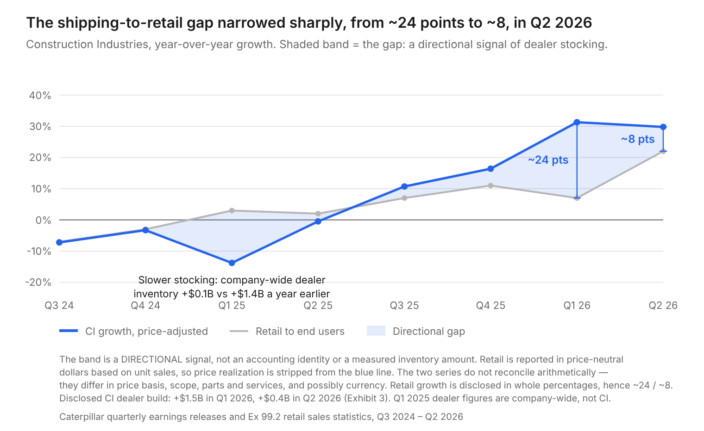

# Caterpillar Demand Quality

## 1. Project question
Was Caterpillar's 2026 Construction Industries growth driven by real end-user demand or dealer restocking?

## 2. One-sentence finding
Caterpillar's Construction Industries growth leaned heavily on dealer restocking in Q1 2026; by Q2 the evidence points to a material shift toward end-user demand.

## 3. Key evidence

- **8** quarters analyzed, Q3 2024 – Q2 2026
- **28 / 32** sales bridges reconcile independently — 4 additional checks require caveats: 3 use back-solved prior-year values; 1 depends on a component disclosed only as "$3.1B"
- **5-level** evidence classification — sourced · derived · back-solved · not collected · not disclosed
- **16** comparability issues logged

A bridge is Caterpillar's own disclosed volume, price realization, currency, and inter-segment components tested against its reported sales change, for three segments and the consolidated total across eight quarters. All 32 checks return zero, but four are not independent: three use a prior-year figure back-solved from the bridge itself, and one depends on a component disclosed only as "$3.1 billion". Reconciliation demonstrates internal consistency with those components, not that the right line items were chosen.

| Construction Industries | Q1 2026 | Q2 2026 |
|---|---:|---:|
| Disclosed CI dealer-inventory build | $1.5B | $400M |
| Volume driver named first (order of mention) | dealer inventories | end users |
| Adjusted reported-vs-retail gap | ~24 pts | ~8 pts |
| Retail sales growth to end users | 7% | 22% |
| Reported CI sales growth | 38.1% | 34.8% |

Reported growth barely moved. What produced it changed. The order of mention is sourced; reading it as a shift in the drivers' relative size is an analytical inference, consistent with the dealer-inventory dollars but not a disclosure of magnitude.

> Read the reported-vs-retail gap as a **directional** indicator of dealer stocking, not as an exact dollar measurement of inventory. The two disclosures differ in price basis, scope, the treatment of parts and services, and possibly currency.

## 4. Hero exhibit

*Construction Industries, year-over-year growth. Shaded band = the gap: a directional signal of dealer stocking.*

The band is a DIRECTIONAL signal, not an accounting identity or a measured inventory amount. Retail is reported in price-neutral dollars based on unit sales, so price realization is stripped from the blue line. The two series do not reconcile arithmetically — they differ in price basis, scope, parts and services, and possibly currency. Retail growth is disclosed in whole percentages, hence ~24 / ~8 points. Disclosed CI dealer build: +$1.5B in Q1 2026, +$0.4B in Q2 2026. The Q1 2025 annotation ("slower stocking") uses company-wide dealer figures, not CI.

*Source: Caterpillar quarterly earnings releases and Ex 99.2 retail sales statistics, Q3 2024 – Q2 2026.*

## 5. What the project demonstrates
- Segment-level reconciliation discipline: 28 of 32 volume/price/currency/inter-segment bridges close to zero independently, and the four that cannot (three with a back-solved prior-year value, one depending on a "$3.1B" rounded disclosure) are identified rather than counted as passes.
- A five-level evidence classification (SOURCED / DERIVED / BACK-SOLVED / NOT COLLECTED / NOT DISCLOSED, with INFERRED used only in notes) applied to every figure. No figure is an estimate; the four back-solved values are flagged in the workbook.
- A logged comparability record: segment renames, a prior-year restatement, and a retail-basis wording change are surfaced and tested rather than smoothed over or hidden.
- A forward view stated as a falsifiable inference, with explicit conditions that would strengthen, weaken, or redirect the thesis — including an alternative hypothesis (demand pull-forward) and one expected corroboration (cash flow) that didn't hold up.
- Correct handling of a cost-shock distortion: ex-tariff margin is explicitly framed as an upper bound, not claimed as an efficiency or cost-control result.

## 6. Forward judgment: what this implies, and what would break it

*Stated as inference, not finding. All three describe H2 2026, which had not been reported when this was written.*

If dealer inventory stops building or draws down in H2 2026 while end-user demand holds, dealer stocking should contribute less to reported CI growth. Reported growth should therefore move closer to retail growth, or temporarily trail it during destocking. (Management expects a Q4 2026 Construction Industries dealer-inventory drawdown: CFO Kyle Epley said Caterpillar expects "a more typical reduction in Construction Industries dealer inventory of over $1 billion in the fourth quarter," and CEO Joseph Creed said "We'll have a drawdown in the fourth quarter on CI dealer inventory." (Q2 2026 call).)

- **Strengthens the thesis** — Retail growth remains elevated while dealer inventory growth continues to slow or turns negative.
- **Weakens the thesis** — Retail growth falls materially in H2 while dealer inventories draw down, suggesting Q2's 22% was a temporary spike rather than evidence of durable end demand.
- **Alternative: demand pull-forward** — Positive tariff-related price realization may have encouraged some customers to purchase earlier than planned, inflating Q2 retail at the expense of H2. A hypothesis, not a proven fact. H2 retail behavior should distinguish durable demand from pull-forward.

**What I expected to corroborate — and didn't:** inventory-heavy Q1 2026 growth was expected to show up as unusually weak cash conversion. It didn't — Q1 is seasonally weak and Q1 2026 operating cash flow was stronger than Q1 2025, so cash flow does not independently confirm the stocking thesis. It is reported here because leaving it out would be selective.

## 7. Methodology and auditability

Financial figures are sourced to Caterpillar and SEC filings wherever available: quarterly earnings releases Q3 2024 – Q2 2026, Ex 99.2 Rolling 3-Month Retail Sales Statistics, and the Q1 and Q2 2026 Forms 10-Q (accessions 0000018230-26-000021 and -000046). Management commentary not reproduced in a filing is identified as earnings-call commentary and supported by transcript sources. No third-party estimates or analyst summaries are used as financial inputs. Where the 10-Q documents would not serve Item 2 on retrieval, figures were confirmed by exact-phrase match against the EDGAR full-text index — present in the filing, though the surrounding sentence was not read.

Every figure in the workbook is classified on five levels — SOURCED, DERIVED, BACK-SOLVED, NOT COLLECTED or NOT DISCLOSED — with CALC marking live formula rows and INFERRED used in notes where a filing's scope or period qualifier could not be recovered. No figure is an estimate. Four figures are BACK-SOLVED residuals (shown in orange and noted in the workbook); any bridge that uses one is not counted as an independent reconciliation.

Full detail: [`docs/methodology.md`](docs/methodology.md) · [`docs/sources.md`](docs/sources.md) · [`docs/definitions.md`](docs/definitions.md)

## 8. Limitations
- The reported-vs-retail gap is directional and relative, not a precise dealer-inventory dollar measure.
- Q2 2026 retail strength is a single observation and needs H2 confirmation.
- Segment-level dealer-inventory dollars are not disclosed continuously, so no unbroken eight-quarter series exists at either scope.
- Ex-tariff margin is an upper bound on underlying performance, not a clean efficiency measure: the price realization that lifted it was taken partly to recover the same tariff costs.
- The Q4 2025 and Q1 2026 tariff figures are disclosed manufacturing-cost lines that Caterpillar said "largely" reflected tariffs; the Q2 2026 figure is 340 bps disclosed on the earnings call, converted to about $284M here (derived). The two methods are not comparable as a trend.
- The pressure test supports direction only: the gap-implied stocking swing has the right sign in all four testable quarters, but no magnitude can be tested because prior-year builds are unquantified or the scopes differ.
- The change in management's driver order is sourced; reading it as a change in the drivers' relative size is an analytical inference.
- Q1 is seasonally a dealer build quarter (management called the Q1 2026 build "a more typical $1.5 billion increase in the first quarter"), so part of the sequential $1.5B → $400M decline may be seasonal.
- Management expects a Q4 2026 Construction Industries dealer-inventory drawdown: CFO Kyle Epley said Caterpillar expects "a more typical reduction in Construction Industries dealer inventory of over $1 billion in the fourth quarter," and CEO Joseph Creed said "We'll have a drawdown in the fourth quarter on CI dealer inventory." Management also expects full-year 2026 tariff costs of around $2.2 billion, excluding approximately $400 million of expected IEEPA tariff recoveries, at the low end of its prior range; for Q3 it expects tariff costs of around $600 million with about 50% incurred in Construction Industries (Q2 2026 call).

## 9. Downloads / files

| File | Description |
|---|---|
| [`analysis/Caterpillar_Demand_Quality_Case_Study.pdf`](analysis/Caterpillar_Demand_Quality_Case_Study.pdf) | Full written case study |
| [`model/CAT_8Q_Operating_Dataset.xlsx`](model/CAT_8Q_Operating_Dataset.xlsx) | Eight-quarter dataset, 32 sales bridge checks (28 independent), source and five-level classification for every figure, comparability log |
| [`docs/methodology.md`](docs/methodology.md) | Sourcing rules, classification scheme, verification method |
| [`docs/sources.md`](docs/sources.md) | Every source document, with direct links |
| [`docs/definitions.md`](docs/definitions.md) | Classification scheme and tab-by-tab dataset definitions |
| [`assets/`](assets/) | Exhibit charts, light theme (PNG and SVG where available) |
| [`assets/dark/`](assets/dark/) | Exhibit charts, dark theme where available (Exhibits 1–4 and 6) |
